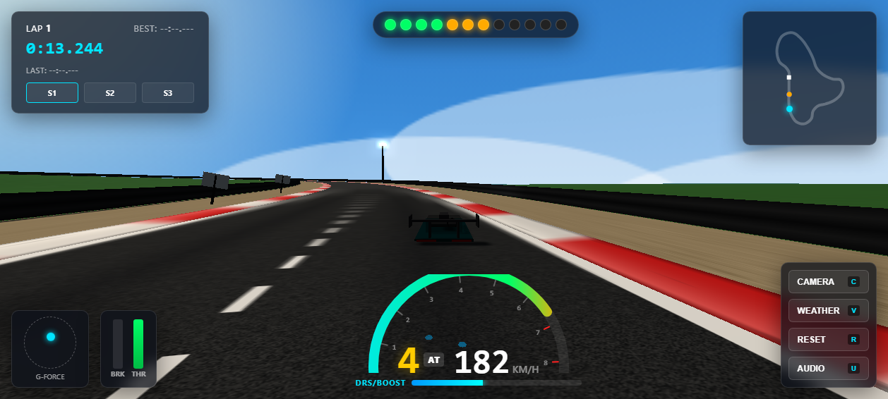
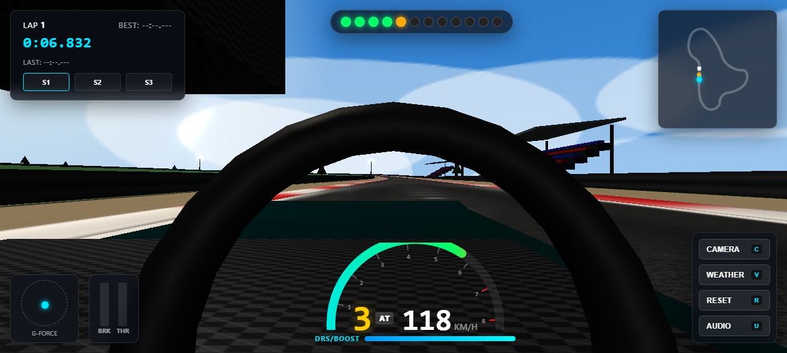
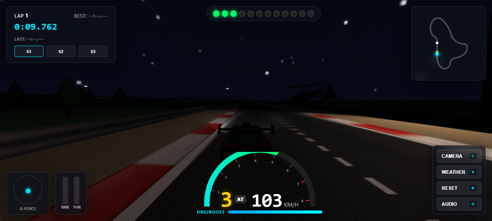
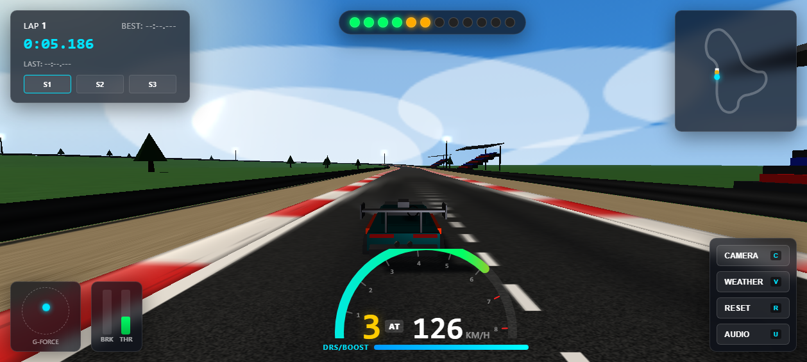

# 🏎️ Apex Grand Prix 3D - WebGL 拟真网页赛车游戏引擎

[](https://github.com/lxm18-thursday/web-racing/actions/workflows/deploy.yml)
[](https://lxm18-thursday.github.io/web-racing/)
[](https://vitejs.dev/)
[](https://threejs.org/)
[](https://pmndrs.github.io/cannon-es/)
[](https://www.typescriptlang.org/)

> 基于 **Vite + TypeScript + Three.js + Cannon-es** 从零构建的高性能、高拟真度 3D 网页赛车物理仿真游戏。恪守**零外部死链资产原则**：全车几何体、PBR 贴图、2.8 公里专业赛道、天空盒与环境反射均为代码**程序化生成（Procedural Generation）**；所有发动机声浪、胎噪、换挡回火声均由 **Web Audio API** 实时多振荡器调制合成。

---

## 📸 游戏实机效果一览

| 极速状态（180+ km/h 动态速度线与 Bloom 辉光） | 第一人称座舱视角（带转动方向盘与 G 值倾角） |
| :---: | :---: |
|  |  |

| 夜间车灯与赛道照明塔模式 | 追尾视角与起步发车格 |
| :---: | :---: |
|  |  |

---

## 🌟 核心特性与技术架构

### 1. 深度调校的拟真车辆动力学（Vehicle Dynamics & Physics）
- **四轮独立悬挂仿真**：基于 `cannon-es.RaycastVehicle`，精准配置前/后轮悬挂刚度（35 N/m）、压缩阻尼（4.4）与回弹阻尼（2.6），并引入防倾杆侧倾影响因子（`rollInfluence: 0.12`），在高速过弯、刹车俯仰与压上路肩时呈现逼真的车身重心转移（Weight Transfer）。
- **随速衰减转向系统（Speed-Sensitive Steering）**：
  采用非线性平滑衰减函数 $\theta_{\max}(v) = \frac{0.54}{1 + (v/300)^2 \times 5.6}$，低速发卡弯提供最大 31° 打满转向，车速超过 180 km/h 时自适应收敛至 10°~12° 稳定切弯区间，配合动态转向阻尼回正速率，彻底根治高速下轻点方向键导致失控打转的问题。
- **差异化轮胎滑移力学与多路面交互**：
  - 前轮与后轮独立设置摩擦系数（`frictionSlipFront: 2.9`, `frictionSlipRear: 3.1`），配合 60:40 前后刹车偏置与机械手刹锁死后轮机制，实现可控的甩尾侧滑（Drifting）与反打循迹。
  - **路面材质物理判定**：根据车辆偏离赛道中线的法向距离实时识别路面类型：
    - **柏油赛道（Tarmac, $\le 7\text{m}$）**：抓地力 100%，标准滚动阻力。
    - **红白路肩（Curbs, $7.0\text{m} \sim 8.8\text{m}$）**：抓地力 85%，触发 48Hz 车体与摄像机高频微震动。
    - **砂石缓冲区（Gravel Runoff, $8.8\text{m} \sim 14.8\text{m}$）**：抓地力降至 55%，施加反向滚动阻力减速。
    - **草地荒野（Grass, $> 14.8\text{m}$）**：抓地力骤降至柏油路面的 **40%**，增加大幅阻力并造成转向迟滞。
- **动力总成与 6 速序列式变速箱**：
  - 模拟真实高转速自然吸气/涡轮内燃机扭矩曲线（Idle: 900 RPM，峰值扭矩区间 4500~6500 RPM，红线转速: 8500 RPM）。
  - 支持 **自动挡（AT）与手动拨片换挡（MT）** 随时一键无缝切换。
  - 模拟换挡动力中断（Shift Cut Delay ~140ms）并伴随排气管多段回火爆鸣（Backfire Pops）。
  - **DRS / 氮气增压系统（Nitro Boost）**：释放额外超强推力，伴随排气管氮气喷射粒子与视野动态拉伸。
- **空气动力学（Aerodynamics）**：
  - 根据车速平方（$v^2$）实时计算下压力（Downforce）与空气阻力（Drag），赋予赛车在 200+ km/h 高速大弯道中紧紧吸附赛道的超强过弯极限。

### 2. 动态视觉特效与后处理管线（VFX & Post-Processing）
- **动态轮胎胎痕（Skid Marks）**：
  - 采用 **环形缓冲区（Ring Buffer）** 几何体架构（1200 个 Quad 条带面元，单次 Draw Call 批量渲染）。
  - 四轮独立追踪滑移状态：当轮胎发生大角度侧滑（Slip Angle 超阈值）或重刹抱死（Lockup）时，在赛道路表动态生成带贴地透明度的橡胶胎痕网格，配合 `polygonOffset` 杜绝 Z-fighting。
- **程序化粒子系统（Particle FX）**：
  - HTML5 Canvas 动态生成半透明烟雾、尘土与草屑粒子贴图。
  - 沥青路面打滑起步与漂移时喷射白色胎烟（Tire Smoke）；冲出赛道进入砂石缓冲区或草地时动态扬起飞溅的尘土与草屑碎块。
- **Three.js EffectComposer 后处理**：
  - **UnrealBloomPass 真实辉光**：精心校准高光阈值，让赛车刹车灯、双透镜前大灯、发车龙门架信号灯和仪表盘换挡灯产生极致光晕，同时避免天空白云大面积过曝。
  - **180+ km/h 动态速度线与径向模糊**：自定义 GLSL `SpeedEffectShader`，极速时边缘产生辐射状运动模糊、微妙色差与光芒拉丝。
  - **48Hz 压路肩摄像机微震动（Camera Shake）**：配合车震颠簸与气动湍流，提供强烈的路感反馈。

### 3. 2.8 公里闭合专业赛道与程序化场景（Track & Environment）
- **Catmull-Rom 复合闭合赛道**：包含千米发车大直道、高速扫弯、连续 S 减速弯（Chicane）、高低起伏坡度以及 180 度重刹发卡弯（Hairpin）。
- **程序化 PBR 贴图生成**：沥青骨料路面、FIA 标准立体红白路肩、砾石缓冲区、双波镀锌防撞护栏（Armco Barriers）及发车格斑马线均由 Canvas 动态生成。
- **赛道周边设施**：发车龙门架（带 5 盏发车红灯）、阶梯主看台遮阳棚、150m/100m/50m 刹车指示牌、12 座夜间环道泛光照明塔与低多边形树木植被。
- **4 种多视角摄像机**：
  1. `Chase`：动态追尾视角（带阻尼滞后跟随、高频路肩车震与 60°~78° 速度动态 FOV）。
  2. `Hood`：引擎盖贴地视角（提供极佳贴地冲击感与弯心盲区观察）。
  3. `Cockpit`：座舱第一人称视角（方向盘随按键偏转，横向 G 值头部侧倾倾角）。
  4. `Helicopter`：直升机/无人机高空俯瞰视角（TV 电视转播级全局追踪）。
- **3 种天气与光影模式**：
  1. **晴天正午**（Sunny）：高角度强日光、蓝天白云、清晰柔和阴影（PCFSoftShadowMap）。
  2. **黄昏夕阳**（Sunset）：金橙色逆光、长投影、紫色暮光天顶。
  3. **夜间模式**（Night）：深邃星空月夜、赛车前大灯（双聚光灯照射并投射动态阴影）、赛道泛光灯全开。

### 4. Web Audio API 纯程序化音效合成（Zero External Audio）
- **双振荡器 + 饱和失真内燃机声浪**：Sawtooth 基频 + Square 次泛音（微调 +1.8 音分增厚）+ Triangle 亚低音共振，经过 WaveShaper 软削波失真与低通滤波，随 RPM 与节气门开度平滑无级变频。
- **赛用直齿变速箱啸叫（Straight-Cut Dog-Ring Gearbox Whine）**：模拟 GT3 赛车高频直齿狗齿变速箱齿轮咬合蜂鸣音（420Hz ~ 2800Hz），随车速与负荷动态啸叫。
- **涡轮泄压阀吹鸣（Turbo Blow-Off Valve / Wastegate Flutter）**：全油门高速急收油时触发逼真的 4 段共鸣脉冲式排气泄压阀泄压吹哨音（BOV Flutter）。
- **FIA 倒计时蜂鸣与起步号角**：红灯阶段逐级阶梯音高蜂鸣，绿灯起步高亮三和弦发车提示。
- **高转升挡排气回火（Backfire Pops）**：升挡动力中断时触发多段短促低沉的爆鸣声。
- **双层尖锐胎叫（Tire Squeal & Screech）**：1400Hz ~ 2300Hz 动态调频振荡器与滑移摩擦白噪，随侧滑角深浅动态加剧。
- **环境物理音效**：高速风噪（Aero Wind）、压路肩振动音（Curb Rumble）与换挡机械咔哒声。

### 5. 专业级遥测 HUD 与赛事 AI 系统（Telemetry & AI）
- **FIA 5 盏起步红灯倒计时发车系统**：
  - 点击“START ENGINE”后，发车龙门架物理灯组与 HUD 5 盏红色大灯逐级点亮，伴随低沉阶梯提示音。
  - 5 盏全亮后随机延迟熄灭 ("LIGHTS OUT AND AWAY WE GO!")，并伴随绿色起步横幅。
  - **弹射起步驻车保持（Launch Control Staging Hold）**：红灯就位期间，踩死刹车/手刹时轰油门可将转速轰至 8000 RPM 红线蓄力，车身绝不溜车滑移。
- **刹车盘高热炽热辉光（Dynamic Brake Rotor Heat Glow）**：重刹制动时盘面温度瞬间飙升至 800°C~1000°C，透过轮毂条幅辐射出炽热暗红至橙金色的 Bloom 真实金属热发光。
- **主动式 DRS 尾翼翼片调节（Active Aero DRS Wing）**：释放氮气超强推进时尾翼翼片自动平躺（Low-Drag DRS Mode），日常减速恢复下压力倾角。
- **数字车速表与弧形转速表**：高刷新率 Canvas 仪表盘，配备 12 颗换挡提示灯（绿 -> 黄 -> 红 -> 超转蓝光频闪）。
- **实时排位看板（Live Race Position P1-P4）**：全场 4 辆赛车沿赛道进程动态计算排位，并在左上角实时显示 P1-P4 奖杯徽章。
- **G 值球遥测仪（G-Force Meter）**：实时监测横向向心加速度与纵向加减速 G 值球轨迹。
- **赛事计时看板**：实时圈速、历史最佳圈速、上圈圈速，以及 **Sector 1 / Sector 2 / Sector 3** 计时赛段紫（全场最快）/ 绿（个人最佳）/ 黄（落后）色彩差值提示。
- **动态小地图（Mini-Map）**：实时绘制完整赛道轮廓、发车线、玩家车身实时朝向青色箭头与 3 辆 AI 赛车实时位置。
- **3 辆独立涂装 AI 赛车**：法拉利红（#77）、电光蓝（#12）、毒液黄（#33），基于航点轨迹与前瞻距离执行 PID 转向、弯前自动重刹入弯与不同车道线超车。

---

## ⚙️ 车辆物理引擎调校核心参数说明

| 参数类别 | 变量名 / 属性 | 取值 / 范围 | 物理含义与实机调校效果 |
| :--- | :--- | :--- | :--- |
| **车身刚体** | `chassisMass` | $1200\text{ kg}$ | 赛车整备质量，设定惯性张量与重量分布 |
| **悬挂刚度** | `suspensionStiffness` | $35.0\text{ N/m}$ | 悬挂弹簧硬度，高速变向时抗俯仰支撑性强 |
| **压缩阻尼** | `dampingCompression` | $4.4\text{ Ns/m}$ | 轮胎受压吸震阻尼，压路肩时防止车身弹起失控 |
| **回弹阻尼** | `dampingRelaxation` | $2.6\text{ Ns/m}$ | 悬挂拉伸回弹阻尼，消除跳跃后的持续车身晃动 |
| **悬挂行程** | `maxSuspensionTravel` | $0.28\text{ m}$ | 悬挂最大允许上下伸缩行程 |
| **防倾杆因子** | `rollInfluence` | $0.12$ | 模拟前后机械防倾杆，高速过弯时抑制过量侧倾 |
| **前轮摩擦** | `frictionSlipFront` | $2.9$ | 前转向轮横向抓地力，确保敏锐切弯入弯指向性 |
| **后轮摩擦** | `frictionSlipRear` | $3.1$ | 后驱动轮横向抓地力，提供强大的直道加速牵引力 |
| **随速转向** | `maxSteerAngle(v)` | $0.54 \to 0.18\text{ rad}$ | 随车速自适应衰减最大转向角，杜绝高速失控打转 |
| **发动机转速** | `idleRPM` / `redlineRPM` | $900 \to 8500\text{ RPM}$ | 发动机怠速至红线转速，驱动扭矩曲线与音效基频 |
| **变速箱齿比** | `gearRatios[1~6]` | $3.82 \to 0.81$ | 6 速序列式齿轮箱齿比，配合终传比 $3.65$ |
| **空气下压力** | `downforceCoefficient` | $1.42\text{ N}/(\text{m/s})^2$ | 车身与尾翼下压力，随速度平方递增吸附路面 |
| **空气阻力** | `dragCoefficient` | $0.38\text{ N}/(\text{m/s})^2$ | 高速气动阻力，决定极限极速与巡航加速衰减 |
| **草地抓地力** | `grassGripFactor` | $0.40$ (40%) | 冲出赛道进入草地时的抓地力衰减比例 |
| **砂石抓地力** | `gravelGripFactor` | $0.55$ (55%) | 冲入缓冲区砾石地面的抓地力衰减比例 |

---

## 🎮 按键操作指南

| 操作按键 | 功能分类 | 详细动作说明 |
| :--- | :--- | :--- |
| **W** / **↑ 方向键** | 动力控制 | 踩下油门踏板加速（Throttle） |
| **S** / **↓ 方向键** | 动力控制 | 刹车制动（Brake），静止时切入倒挡（Reverse） |
| **A** / **D** / **← / →** | 转向控制 | 左右转向（Steering，高速自适应阻尼抑制转向角防甩尾） |
| **Space 空格键** | 漂移控制 | 机械手刹（拉起锁死后轮，突破抓地力漂移过弯） |
| **B** 或 **N** 键 | 增压推进 | **DRS / 氮气增压系统**（Nitro Boost 释放极限推进力） |
| **C 键** | 摄像机视角 | 循环切换 **4 种视角**（追尾 -> 引擎盖 -> 座舱第一人称 -> 直升机高空） |
| **M 键** | 变速箱模式 | 切换 **自动挡（AT） / 手动拨片（MT）** |
| **Shift** / **E** 键 | 序列换挡 | 手动模式下：**升挡（Shift Up）**，触发回火爆鸣 |
| **Ctrl** / **Q** 键 | 序列换挡 | 手动模式下：**降挡（Shift Down）**，触发自动补油降挡 |
| **V 键** | 环境照明 | 循环切换 **3 种天气光影**（晴天正午 -> 黄昏夕阳 -> 夜间车灯） |
| **R 键** | 车辆救援 | **重置车辆**（将倒扣、撞停或飞出赛道的车辆扶正复位至赛道） |
| **U 键** | 声学控制 | 静音 / 开启音效（Mute Toggle） |

> 💡 **提示**：屏幕右下角的控制按钮以及转速表上方的换挡闪烁灯均支持鼠标或触控点击。初次进入游戏时请点击屏幕中央 **"START ENGINE"** 激活浏览器 Web Audio 音频上下文。

---

## 🛠️ 本地开发与构建命令

### 1. 克隆与安装依赖
```bash
git clone https://github.com/lxm18-thursday/web-racing.git
cd web-racing
npm install
```

### 2. 启动本地热重载开发服务器
```bash
npm run dev
```
启动后在浏览器中打开 `http://localhost:3000/` 即可体验。

### 3. 生产环境打包验证
```bash
npm run build
```
执行 TypeScript 强类型校验与 Vite 生产压缩，打包产物输出至 `./dist` 目录（已配置 `base: './'` 相对路径）。

### 4. 本地预览生产构建产物
```bash
npm run preview
```

---

## 🚀 GitHub Actions 自动化部署流水线

本项目已配置完整的 CI/CD 工作流文件 [`.github/workflows/deploy.yml`](.github/workflows/deploy.yml)。

### 部署流程：
1. **自动触发**：当代码推送到 `main` 分支时自动触发流水线。
2. **构建步骤**：
   - 检出源码（`actions/checkout@v4`）
   - 初始化 Node.js 20 运行环境（`actions/setup-node@v4`）
   - 安装依赖并编译打包（`npm ci` && `npm run build`）
   - 配置 Pages 凭据（`actions/configure-pages@v5`）
   - 打包并上传 `./dist` 静态资源产物（`actions/upload-pages-artifact@v3`）
   - 正式发布至 GitHub Pages（`actions/deploy-pages@v4`）
3. **开启 GitHub Pages**：
   - 进入 GitHub 仓库设置：**Settings** -> **Pages**。
   - 在 **Build and deployment** 下将 **Source** 切换为 **GitHub Actions**。
   - 每次代码推送至 `main` 即可自动秒级更新上线！

---

## 📂 项目模块代码目录树

```text
web-racing/
├── .github/
│   └── workflows/
│       └── deploy.yml            # GitHub Actions 自动化构建与 Pages 部署工作流
├── docs/
│   └── screenshots/              # 游戏实机高清全景效果图
├── src/
│   ├── audio/
│   │   └── SoundEngine.ts        # Web Audio API 纯程序化引擎声浪、胎噪、换挡燃爆合成器
│   ├── physics/
│   │   ├── PhysicsWorld.ts       # Cannon-es 物理世界配置、SAP 碰撞广播与材质刚度
│   │   └── TrackPhysics.ts       # 赛道地面 Trimesh 碰撞体与防撞护栏刚体
│   ├── rendering/
│   │   ├── CameraController.ts   # 4 视角控制、速度动态 FOV、48Hz 车震微抖动与 G 值偏转
│   │   ├── LightingManager.ts    # 动态太阳光阴影追踪、晴天/黄昏/夜景天气照明系统
│   │   ├── ParticleManager.ts    # 胎烟白雾、排气回火烈焰、泥土碎石与草屑粒子系统
│   │   ├── SceneManager.ts       # Three.js 渲染器、EffectComposer、UnrealBloomPass 辉光
│   │   ├── SkidMarkManager.ts    # 环形缓冲区动态轮胎印记网格管理器（批量单 Draw Call）
│   │   ├── SkyboxGenerator.ts    # 动态 Canvas 渐变天空球与程序化星空月亮
│   │   ├── SpeedEffectShader.ts  # 自定义 GLSL 极速边缘径向模糊与穿梭动态速度线
│   │   └── TextureGenerator.ts   # 程序化 PBR 沥青、FIA 赛道路肩、碳纤维、打孔刹车盘贴图
│   ├── track/
│   │   ├── TrackData.ts          # 2.8 公里 CatmullRomCurve3 赛道闭合曲线与赛段定义
│   │   ├── TrackMeshGenerator.ts # 3D 赛道面、立体路肩、缓冲区、波形护栏与草地地形生成
│   │   ├── TrackScenery.ts       # 发车龙门架（5 发车灯）、阶梯看台、夜赛照明塔与植被
│   │   └── TrackWaypoints.ts     # 赛道高精度采样航点、弯道极限速度计算与进度寻路
│   ├── vehicles/
│   │   ├── AISystem.ts           # 3 辆独立涂装 AI 赛车状态机、航点追踪与超车避让
│   │   ├── CarModelGenerator.ts  # 纯程序化流线型 GT 赛车几何体组合、车轮与刹车灯
│   │   ├── InputManager.ts       # 键盘输入阻尼平滑与单次按键触发管理
│   │   ├── RaycastVehiclePhysics.ts # Cannon-es RaycastVehicle 悬挂调校、空气动力学与路面抓地力
│   │   ├── VehicleController.ts  # 6 速序列式变速箱、扭矩曲线、自动/手动挡与遥测统筹
│   │   └── VehicleTypes.ts       # 输入状态、遥测数据与涂装配置类型定义
│   ├── ui/
│   │   └── HUD.ts                # 专业遥测仪表盘、换挡提示灯、圈速赛段板与动态小地图
│   └── main.ts                   # 游戏主启动程序、主渲染更新循环与模块调度
├── index.html                    # 游戏入口 HTML5 网页
├── package.json                  # 项目依赖与 npm 脚本配置
├── tsconfig.json                 # TypeScript 强类型编译配置
├── vite.config.ts                # Vite 相对路径打包配置（base: './'）
└── README.md                     # 项目详细中英文档
```

---

## 📄 开源许可证

本项目基于 [MIT License](LICENSE) 开源。
